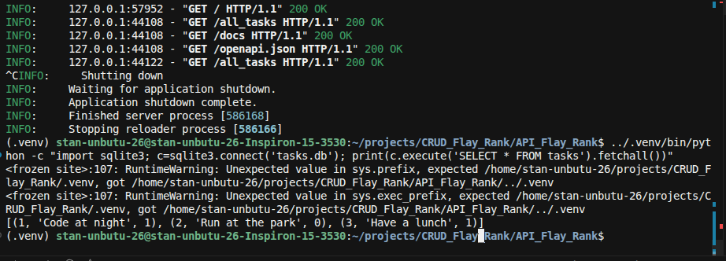

# Task API


A small CRUD API for managing a to-do list, built with **FastAPI** and **Postgres**.

The endpoints are the same as before. Tasks are stored in Postgres, running in Docker. `task_service.py` and `routes_tasks.py` were not changed for this swap. Only the repository, the database connection, and the Docker files changed.

---

## 1. What to install

You need Python 3.10+ installed. Then install the two dependencies listed in `requirements.txt`:

```
fastapi==0.139.2
uvicorn==0.51.0
```

Install them with:

```bash
pip install -r requirements.txt
```

## 2. How to run it (one command)

```bash
cd API_Flay_Rank
uvicorn app.main:app --reload
```

This starts the server at `http://localhost:8000`.

## 3. Where to view the API

Open your browser at:

```
http://localhost:8000/docs
```

This is **Swagger UI** — an interactive page that lists every endpoint and lets you test them with a "Try it out" button, no `curl` needed.


---

## Step-by-step: checking each endpoint

Below is every endpoint, in the order you'd naturally test them, with how to run it and what response to expect. First the "is it alive?" routes, then the full CRUD cycle (Create, Read, Update, Delete).

### Step 1 — `GET /` (Root)

**What it does:** confirms the server is up and shows basic info about the API.

**How to run it:**
```bash
curl -i http://localhost:8000/
```

**Expected response:** status `200 OK` with the API's name, version, and list of endpoints.


---

### Step 2 — `GET /health` (Health check)

**What it does:** a simple check real companies use to confirm the server is alive.

**How to run it:**
```bash
curl -i http://localhost:8000/health
```

**Expected response:** status `200 OK` with `{"status": "ok"}`.


---

### Step 3 — `GET /hello` (Sample message)

**What it does:** returns a simple greeting message, just to test a basic route.

**How to run it:**
```bash
curl -i http://localhost:8000/hello
```

**Expected response:** status `200 OK` with `{"message": "Hello World!"}`.


---

### Step 4 — `GET /all_tasks` (List all tasks — Read)

**What it does:** returns every task currently stored.

**How to run it:**
```bash
curl -i http://localhost:8000/all_tasks
```

**Expected response:** status `200 OK` with a list (array) of task objects, each with `id`, `title`, and `done`.


---

### Step 5 — `GET /tasks/{task_id}` (Get one task — Read)

**What it does:** returns a single task by its id.

**How to run it:**
```bash
curl -i http://localhost:8000/tasks/1
```

**Expected response (task exists):** status `200 OK` with that task's data.


**What if the id doesn't exist:**
```bash
curl -i http://localhost:8000/tasks/99
```

**Expected response (task missing):** status `404 Not Found` with an error message telling you the task wasn't found.


---

### Step 6 — `POST /tasks` (Create a task)

**What it does:** creates a new task from the JSON you send in the request body.

**How to run it:**
```bash
curl -i -X POST http://localhost:8000/tasks \
  -H "Content-Type: application/json" \
  -d '{"title": "Buy a milk."}'
```

**Expected response:** status `201 Created` with the new task, including its generated `id` and `done: false`.


**What if the title is missing or empty:**
```bash
curl -i -X POST http://localhost:8000/tasks \
  -H "Content-Type: application/json" \
  -d '{"title": ""}'
```

**Expected response:** status `400 Bad Request` — the server rejects it and explains that the title is required. This is a validation rule: the server never trusts the client blindly.


---

### Step 7 — `PUT /tasks/{task_id}` (Update a task)

**What it does:** changes the title and/or done status of an existing task.

**How to run it:**
```bash
curl -i -X PUT http://localhost:8000/tasks/1 \
  -H "Content-Type: application/json" \
  -d '{"title": "Have a great meal."}'
```

**Expected response (task exists):** status `200 OK` with the updated task.


**What if the id doesn't exist:**
```bash
curl -i -X PUT http://localhost:8000/tasks/99 \
  -H "Content-Type: application/json" \
  -d '{"title": "Have a great meal."}'
```

**Expected response:** status `404 Not Found`.


---

### Step 8 — `DELETE /tasks/{task_id}` (Delete a task)

**What it does:** removes a task from the list.

**How to run it:**
```bash
curl -i -X DELETE http://localhost:8000/tasks/1
```

**Expected response (task exists):** status `204 No Content` — success, with an empty body.


**What if the id doesn't exist:**
```bash
curl -i -X DELETE http://localhost:8000/tasks/99
```

**Expected response:** status `404 Not Found`.


---

## 4. Database

SQLite was chosen because the whole database is one file on disk. There is no separate database server to install. Python already includes the `sqlite3` library, so `requirements.txt` stays limited to FastAPI and Uvicorn. The API routes did not change. Only the storage behind them changed.

The file is created automatically the first time the application starts:

```
API_Flay_Rank/tasks.db
```

`tasks.db` is listed in `.gitignore`. Someone who clones the repository does not receive the file. Starting the server creates it, creates the `tasks` table when it is missing, and inserts the three example tasks only when that table is empty.

Start the project from the repository root:

```bash
python3 -m venv .venv
source .venv/bin/activate
pip install -r API_Flay_Rank/requirements.txt
cd API_Flay_Rank
uvicorn app.main:app --reload
```

The server listens on `http://localhost:8000`. If that port is already in use, start it with `--port 8001` and call `http://localhost:8001`.

This query lists only the completed tasks. `done` is stored as `1` for true and `0` for false:

```sql
SELECT * FROM tasks WHERE done = 1;
```



## 5. Postgres in Docker

From the repository root, start the API and the database together:

```bash
docker compose up --build
```

The app is published at `http://localhost:8001`. Inside the Compose network it listens on port 8000. Postgres keeps its data in the named volume `pgdata`.

Copy `.env.example` to `.env`. The real `.env` is gitignored. Inside Docker the app uses `DATABASE_URL` with the host `db`, which is the database service name.

The table is created from `API_Flay_Rank/sql/schema.sql` the first time the volume is empty.

Persistence check: create a task, run `docker compose down`, then `docker compose up -d`, then `GET /all_tasks`. `down` removes the containers and keeps the volume. After the restart the same rows were still there, including a task created before the shutdown (`Buy a milk.`).

## 6. Redis and a title index

Redis runs in the same Compose file. `GET /health` pings it and returns `{"status":"ok","redis":"PONG"}`. Task rows stay in Postgres.

The title index was checked on a table seeded with 10000 extra rows. The query was `SELECT id, title, done FROM tasks WHERE title = 'Task 5000'`.

Before `CREATE INDEX idx_tasks_title ON tasks (title)`, Postgres read the whole table:

```text
Seq Scan on tasks  (cost=0.00..180.05 rows=1 width=14) (actual time=0.435..0.870 rows=1 loops=1)
  Filter: (title = 'Task 5000'::text)
  Rows Removed by Filter: 10003
Planning Time: 0.200 ms
Execution Time: 0.885 ms
```

After the index, the same query used it:

```text
Index Scan using idx_tasks_title on tasks  (cost=0.29..8.30 rows=1 width=14) (actual time=0.037..0.038 rows=1 loops=1)
  Index Cond: (title = 'Task 5000'::text)
Planning Time: 0.220 ms
Execution Time: 0.052 ms
```

The 10000 seed rows were deleted afterward. The index stayed. `GET /all_tasks` still returns the original tasks.

## Endpoint summary

| Method | Path | What it does | Success status | Error status |
|--------|------|---------------|-----------------|---------------|
| GET | `/` | API info | 200 | — |
| GET | `/health` | Health check and Redis ping | 200 | — |
| GET | `/hello` | Sample message | 200 | — |
| GET | `/all_tasks` | List all tasks | 200 | — |
| GET | `/tasks/{task_id}` | Get one task | 200 | 404 if not found |
| POST | `/tasks` | Create a task | 201 | 400 if title missing/empty |
| PUT | `/tasks/{task_id}` | Update a task | 200 | 404 if not found |
| DELETE | `/tasks/{task_id}` | Delete a task | 204 | 404 if not found |

## Stage 6: publish and docs
